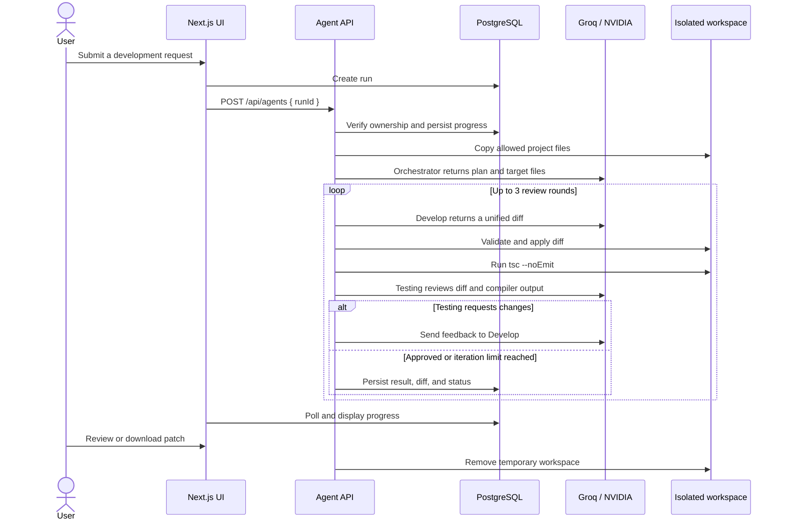

# Crew — AI Agent Workbench

> A review-first AI development workflow: an Orchestrator plans the work, Develop proposes a constrained patch, and Testing checks it before a human decides what to do next.

Crew is a Next.js application with authenticated workspaces, PostgreSQL-backed run history, isolated patch workspaces, and provider failover between Groq and NVIDIA NIM.

**Live demo:** [demo.prostiner.serv00.net](https://demo.prostiner.serv00.net)

## Why Crew

- **Three clear responsibilities:** plan, implement, and independently review.
- **Human-controlled changes:** generated changes are shown and downloadable; they are never applied to the live application.
- **Bounded iteration:** Testing feedback can send Develop back for up to three rounds.
- **Provider resilience:** Groq is primary; NVIDIA NIM is the optional fallback, guarded by an in-process circuit breaker.
- **Observable work:** run status, task status, review feedback, type-check output, and the final diff are persisted and shown in the UI.
- **Private by default:** credentials stay in environment files, and each run uses a temporary workspace.
- **Demo-ready access:** account registration is disabled, sign-in supports a password visibility toggle and an optional remembered session.
- **Bilingual interface:** English and Spanish, with language and light/dark appearance persisted per browser.

## How a run works



See [docs/architecture.md](docs/architecture.md) and [docs/agent-workflow.md](docs/agent-workflow.md) for implementation detail.

## Tech stack

| Area | Choice |
| --- | --- |
| Web application | Next.js 15 App Router, React 19, TypeScript |
| Database | PostgreSQL 16, `pg` connection pool |
| Authentication | scrypt password hashes, signed JWT session cookie |
| Primary inference | Groq OpenAI-compatible Chat Completions API |
| Optional fallback | NVIDIA NIM OpenAI-compatible Chat Completions API |
| Change validation | `git apply` checks and `tsc --noEmit` |
| Hosting | Serv00 Node.js / Passenger |

## Local development

### Prerequisites

- Node.js 20 or newer
- npm
- Docker Desktop (for local PostgreSQL)
- At least one inference key: Groq or NVIDIA NIM

### Start the application

```bash
npm install
cp .env.example .env.local
```

Set the local database password, `AUTH_SECRET`, and at least one provider key in `.env.local`. Then start the app:

```bash
npm run dev
```

The `predev` hook starts the PostgreSQL container and applies the idempotent SQL migrations before launching Next.js. The local database is exposed on `127.0.0.1:55433`.

To run the setup steps separately:

```bash
npm run db:up
npm run db:migrate
```

See [docs/development.md](docs/development.md) for environment variables, file map, and troubleshooting.

## Configuration

Copy `.env.example` to `.env.local`. Never commit `.env.local` or production secrets.

| Variable | Required | Purpose |
| --- | --- | --- |
| `DATABASE_URL` | Yes | PostgreSQL connection string |
| `AUTH_SECRET` | Yes | HMAC signing secret; at least 32 characters |
| `GROQ_API_KEY` | One provider required | Groq primary API key |
| `GROQ_MODEL` | No | Defaults to `openai/gpt-oss-20b` |
| `NVIDIA_API_KEY` | No | NVIDIA NIM fallback API key |
| `NVIDIA_MODEL` | No | Defaults to `nvidia/nemotron-3-nano-omni-30b-a3b-reasoning` |
| `AGENT_WORKSPACE_ROOT` | No | Workspace parent directory; defaults to `.agent-workspaces` |
| `PGSSL` | No | Set to `true` to enable certificate-verified PostgreSQL TLS |

The provider order, retries, breaker behavior, and current limitations are documented in [docs/agent-workflow.md](docs/agent-workflow.md).

## Commands and verification

```bash
npm run dev          # Start local app (also starts DB and migrates)
npm run lint         # Oxlint source lint + TypeScript check (tsc --noEmit)
npm test             # Vitest unit/component tests
npm run test:watch   # Vitest watch mode
npm run build        # Production build and Next.js type validation
npm run db:up        # Start local PostgreSQL container
npm run db:migrate   # Apply SQL migrations
npm run deploy:serv00 # Build and deploy to Serv00
```

Oxlint is the fast source linter; it does not compile the app. `npm run lint` runs Oxlint over `app/`, `lib/`, and `tests/`, followed by the TypeScript compiler. `npm test` runs the Vitest unit/component suite. `npm run build` performs the Next.js production compilation and type validation. There is not yet an automated browser-test runner. Testing in the agent workflow runs the TypeScript compiler and performs an LLM-based diff review; it does not execute generated application code or claim runtime correctness. See [the Playwright MCP E2E checklist](docs/e2e-playwright-mcp.md) for manual browser acceptance.

## Deployment

Production uses Serv00 Node.js / Passenger and PostgreSQL. The deploy script builds locally, syncs the application while excluding environment files, installs production dependencies, and restarts the site.

```bash
npm run deploy:serv00
```

The script expects an SSH alias named `prostiner-serv00`, a configured Serv00 Node.js domain, and an existing remote `.env.production`. Production secrets are stored in that file with mode `600`; `.env*` files are excluded from `rsync`.

GitHub Actions also runs CI for pull requests and pushes to `main`. Production deployment is available as a manual workflow after configuring dedicated SSH secrets; see [the deployment guide](docs/deployment.md#github-actions-deployment).

Deployment topology, required setup, migrations, and operational notes are in [docs/deployment.md](docs/deployment.md).

## Current verification status

- Production build and TypeScript checks pass.
- Authentication and PostgreSQL persistence have been exercised locally and against production.
- NVIDIA API authentication and Groq-to-NVIDIA fallback have been verified without exposing either key.
- The full generated-patch workflow has **not yet passed a repeatable end-to-end acceptance run**. Provider limits and inconsistent model-generated diffs have caused failed smoke runs. The application records these failures; this README does not present them as successful tests.
- The downloaded patch remains review-only and is never applied to production.

See [docs/agent-workflow.md](docs/agent-workflow.md#verification-and-known-limitations) for the exact boundary between implemented behavior and verified behavior.

## AI-assisted development disclosure

This project has been developed with **OpenCode** assistance. The separate evaluation requirement to perform and document a verifiable iteration using Claude Code or Codex remains outstanding; it is not claimed as completed. See [docs/AI_USAGE.md](docs/AI_USAGE.md).

## Documentation map

- [Documentation index](docs/README.md)
- [Architecture](docs/architecture.md)
- [Agent workflow and provider resilience](docs/agent-workflow.md)
- [Security and trust boundaries](docs/security.md)
- [Local development](docs/development.md)
- [Serv00 deployment](docs/deployment.md)
- [Architecture decisions](docs/decisions.md)
- [AI tool usage disclosure](docs/AI_USAGE.md)
- [End-to-end checklist with Playwright MCP](docs/e2e-playwright-mcp.md)
- [Contributor / agent instructions](AGENTS.md)
