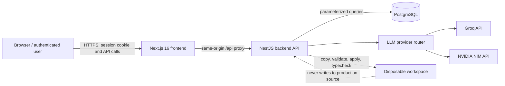
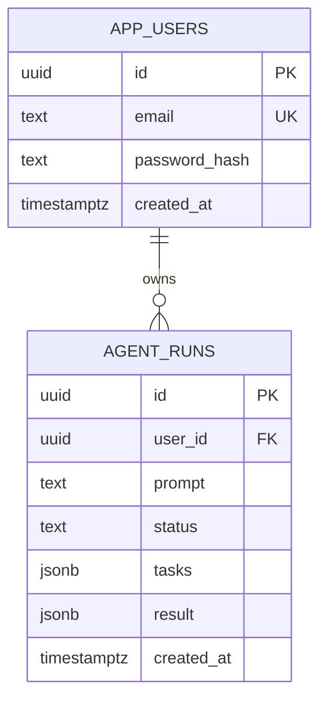
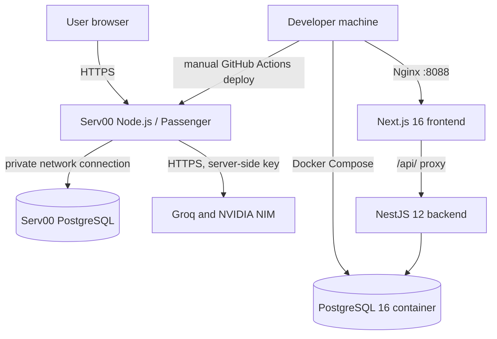

# System Architecture

## System context

Crew is a Next.js 16 frontend and NestJS 12 backend monorepo. Business APIs,
authentication, PostgreSQL persistence, provider integration, and agent
orchestration belong to NestJS. The browser calls the API directly in host
development and through the same-origin Nginx `/api/` proxy in Docker. No
business API handlers remain in Next.js.

Backend code follows the DDD, Clean Architecture, and CQRS conventions in
[architecture-conventions.md](architecture-conventions.md).

## Runtime components

| Component | Responsibility |
| --- | --- |
| `frontend/app/page.tsx` | Authenticated workspace UI, run submission, progress refresh, result/diff presentation |
| `frontend/app/` | Next.js UI and route composition; no business API routes |
| `frontend/lib/backend-api.ts` | Same-origin or configured backend URL, credentials, and locale header |
| `frontend/features/auth/services/session-client.ts` | Frontend session API client |
| `backend/src/domain/` | Framework-independent auth and agent-run domain models |
| `backend/src/application/` | Auth, run, and agent use cases with ports |
| `backend/src/infrastructure/http/` | Controllers, cookies, CORS/origin checks, localized errors |
| `backend/src/infrastructure/persistence/` | PostgreSQL pool and repositories |
| `backend/src/infrastructure/agents/` | Workspace adapter and isolated patch operations |
| `backend/src/infrastructure/providers/` | Groq/NVIDIA routing, retries, failover, circuit state |
| `backend/src/` | NestJS 12 API and `/api/health` |
| `backend/migrations/` | PostgreSQL schema owned by the backend |

## Agent run sequence

1. The UI inserts a run through `PUT /api/runs`, then sends its ID to `POST /api/agents`.
2. The API validates the origin, verifies the signed session, and confirms the run belongs to that user.
3. The Orchestrator receives the user request and a list of candidate UI files. It returns a summary, tasks, and 1–3 target files.
4. The server creates a workspace copy, initializes a local Git baseline, and exposes only selected file contents to Develop.
5. Develop returns a unified diff. The server validates the diff paths, checks it with `git apply --check`, applies it in the copy, and records the diff.
6. Testing runs `tsc --noEmit` in the copy and independently reviews the request, plan, patch, and compiler output.
7. If Testing rejects the patch, its feedback is sent to Develop for another round (up to three total rounds).
8. The final state, tasks, review output, compiler output, and diff are persisted. The temporary workspace is removed in `finally`.
9. The UI refreshes persisted run data and offers the patch as a download. Human review is required before anyone applies it.

## Data model

`agent_runs.tasks` stores the visible task/agent states. `agent_runs.result` stores the plan, proposed diff, changed file list, compiler/review output, iteration count, and pass state. Runs are ordered by `created_at`; user deletion cascades to their runs.

## Hosting topology

Production migration has not been executed. The planned topology uses the existing
Serv00 frontend domain for Next.js and `api.demo.prostiner.serv00.net` for a
separate NestJS Passenger application; the frontend calls the API over HTTPS.
Before deployment, the API subdomain currently configured as a TCP proxy must be
reconfigured as a Node.js Passenger site. Local Compose runs PostgreSQL,
Next.js, NestJS, and Nginx; only Nginx publishes port `8088`.

## Important boundaries

- This is a single application, not a distributed job system. Progress is persisted during the request, but there is no durable queue or background worker.
- The provider circuit breaker is in process memory. It is best-effort and is not shared among multiple server processes or deployments.
- A workspace is an isolated copy with a filesystem allowlist, **not** a hardened container or hostile-code execution environment.
- The app statically type-checks proposed changes; it does not execute generated application code or run a browser test suite.
