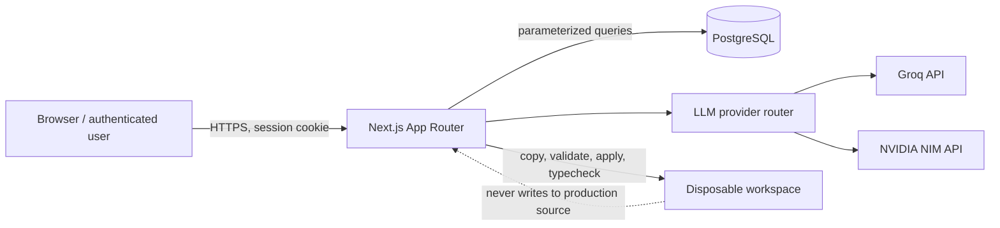
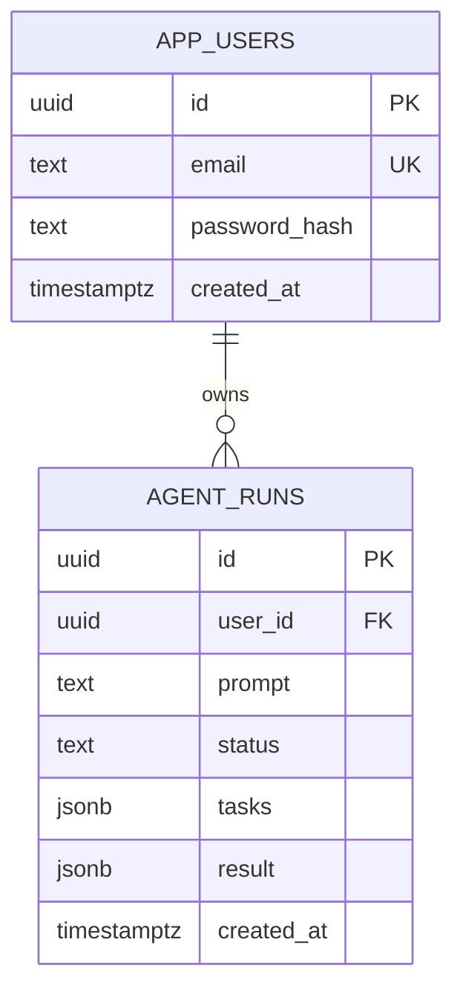
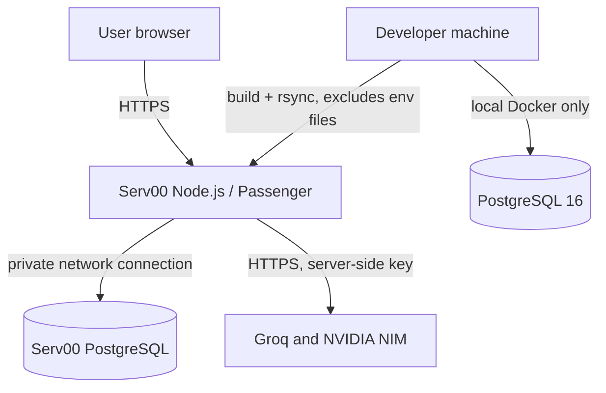

# System Architecture

## System context

Crew is a single Next.js application. The browser talks to authenticated Next.js route handlers; those handlers own PostgreSQL persistence and call external model APIs. No model provider receives database credentials or direct access to the production source tree.

## Runtime components

| Component | Responsibility |
| --- | --- |
| `app/page.tsx` | Authenticated workspace UI, run submission, progress refresh, result/diff presentation |
| `app/api/agents/route.ts` | Authenticated orchestration endpoint; coordinates the run and persists progress |
| `app/api/runs/route.ts` | Reads and upserts user-owned run history |
| `app/api/runs/[id]/patch/route.ts` | Serves a saved patch only to the owner of that run |
| `app/api/auth/*` | Registration, login, session inspection, and logout |
| `lib/llm-provider.ts` | Groq/NVIDIA selection, retries, failover, and in-process circuit state |
| `lib/agent-workspace.ts` | Creates temporary workspace copies, checks file paths, applies patches, type-checks, and cleans up |
| `lib/db.ts` | Shared PostgreSQL connection pool |
| `lib/session.ts` | Signed session tokens, cookie settings, and same-origin validation |
| `migrations/` | PostgreSQL schema for users, runs, task state, and run results |

## Agent run sequence

1. The UI inserts a run through `PUT /api/runs`, then sends its ID to `POST /api/agents`.
2. The API validates the origin, verifies the signed session, and confirms the run belongs to that user.
3. The Orchestrator receives the user request and a list of candidate UI files. It returns a summary, tasks, and 1–3 target files.
4. The server creates a workspace copy, initializes a local Git baseline, and exposes only selected file contents to Develop.
5. Develop returns a unified diff. The server validates the diff paths, checks it with `git apply --check`, applies it in the copy, and records the diff.
6. Testing runs `tsc --noEmit` in the copy and independently reviews the request, plan, patch, and compiler output.
7. If Testing rejects the patch, its feedback is sent to Develop for another round (up to three total rounds).
8. The final state, tasks, review output, compiler output, and diff are persisted. The temporary workspace is removed in `finally`.
9. The UI refreshes persisted run data and offers the patch as a download. Human review is required before anyone applies it.

## Data model

`agent_runs.tasks` stores the visible task/agent states. `agent_runs.result` stores the plan, proposed diff, changed file list, compiler/review output, iteration count, and pass state. Runs are ordered by `created_at`; user deletion cascades to their runs.

## Hosting topology

The production deployment is a single Serv00 Node.js application using Passenger. The database is a separate Serv00 PostgreSQL service. Local development uses Docker PostgreSQL because direct SSH port forwarding from the development machine is unavailable in this setup.

## Important boundaries

- This is a single application, not a distributed job system. Progress is persisted during the request, but there is no durable queue or background worker.
- The provider circuit breaker is in process memory. It is best-effort and is not shared among multiple server processes or deployments.
- A workspace is an isolated copy with a filesystem allowlist, **not** a hardened container or hostile-code execution environment.
- The app statically type-checks proposed changes; it does not execute generated application code or run a browser test suite.
